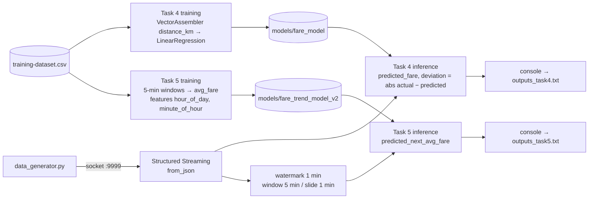

# Spark Streaming + MLlib Fare Prediction

Real-time machine learning on a live ride-sharing feed with **Spark Structured Streaming** and **MLlib**. Two models are trained offline and applied to streaming events: per-trip fare prediction with deviation scoring, and fare-trend prediction over sliding 5-minute windows.


## Problem

Detecting unusual fares as they happen, whether overcharges, glitches or fraud, means scoring every trip the moment it arrives against what a model expects. This project wires an offline-trained MLlib model into a streaming job so that predictions and deviations are produced continuously, with identical feature engineering for training and inference.

## Architecture



## Tech stack

| Area | Tools |
|---|---|
| Streaming | Spark Structured Streaming (socket source, watermarks, sliding windows) |
| ML | Spark MLlib: `VectorAssembler`, `LinearRegression`, model save and load |
| Data | Python socket generator (Faker), CSV training set |

## How to run

**Prerequisites:** Python 3, Java 17, `pip install -r requirements.txt` (pyspark, faker). The saved models in `models/` were written with Spark 4.0.1.

```bash
# Terminal 1
python3 data_generator.py

# Terminal 2: trains models/fare_model on first run, then scores the stream
python3 task4.py | tee outputs_task4.txt

# Terminal 3: trains models/fare_trend_model_v2 on first run, then predicts window trends
python3 task5.py | tee outputs_task5.txt
```

Delete a folder under `models/` to force retraining.

## Results

From [`outputs_task4.txt`](outputs_task4.txt) and [`outputs_task5.txt`](outputs_task5.txt):

- **Task 4:** scored **108 live trips across 109 micro-batches**, with a mean absolute deviation of **$35.55** (median $34.08). For example, a 6.93 km trip charged $124.96 against a predicted $96.45.
- **Task 5:** sliding windows such as 21:29–21:34 (actual average $76.06) received a predicted next-window average of $92.39.

**Interpreting the numbers:** the synthetic generator draws fares almost independently of distance (correlation −0.09 in the 57-row training set). A distance-only model therefore can't beat the mean by much, and high deviations are expected. The value of this project is the **streaming ML plumbing**: offline training, model persistence, consistent features, and real-time scoring with watermarked windows. With real fare data, the same pipeline would flag anomalous trips as they arrive.

## Screenshots

| Task 4: real-time fare prediction | Task 5: fare-trend prediction |
|---|---|
|  |  |

## Repo structure

```
.
├── data_generator.py        # socket server streaming ride events
├── task4.py                 # train/load fare model + streaming inference
├── task5.py                 # train/load trend model + windowed inference
├── training-dataset.csv
├── models/                  # saved MLlib models
├── outputs_task4.txt        # captured streaming output
├── outputs_task5.txt
└── requirements.txt
```
